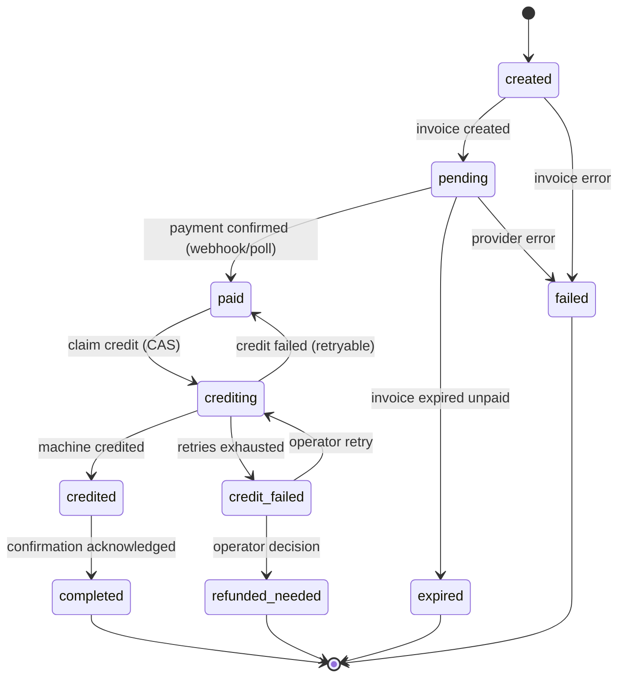

# Lightning Vend — Design

## 1. Monorepo layout
```
/lightning-vend
  package.json            # workspaces, shared scripts
  tsconfig.base.json      # strict, shared
  .env.example
  /shared   types.ts schemas.ts constants.ts config.ts   (no runtime deps but zod)
  /server   Fastify app, repos, state machine, adapters, jobs
  /kiosk    Vue 3 + TS + Vite (customer tablet UI)
  /admin    Vue 3 + TS + Vite (operator dashboard)
  /docs     requirements.md design.md tasks.md
  /e2e      Playwright
  Dockerfile docker-compose.yml .github/workflows/ci.yml
```

## 2. Server stack
Fastify (schema validation via `fastify-type-provider-zod` or manual zod), `better-sqlite3`, `pino`. Plugins: `@fastify/helmet`, `@fastify/cors`, `@fastify/rate-limit`, `@fastify/cookie`, `@fastify/csrf-protection`, `@fastify/under-pressure` (optional).

## 3. Data model (SQLite)
- `orders(id TEXT PK, status TEXT, provider TEXT, provider_charge_id TEXT, amount REAL, currency TEXT, sats INT, payreq TEXT, exchange_rate REAL, product_label TEXT, language TEXT, created_at INT, updated_at INT, expires_at INT, paid_at INT, credit_attempts INT DEFAULT 0, credit_claimed_at INT, credited_at INT, credit_error TEXT)`
- `machine_credits(order_id TEXT PK, attempted_at INT, result TEXT, raw TEXT)` — UNIQUE PK enforces at-most-one recorded credit per order.
- `audit_log(id INTEGER PK, ts INT, actor TEXT, action TEXT, entity TEXT, entity_id TEXT, details TEXT)`
- `settings(key TEXT PK, value TEXT)` — operator-editable runtime settings (price, currency, timeouts, language defaults, provider).
- `webhook_seen(id TEXT PK, ts INT)` — replay rejection (TTL-pruned).
- `admin_sessions(token_hash TEXT PK, created_at INT, expires_at INT)` — httpOnly cookie sessions.

## 4. Order state machine

Transitions are validated by `canTransition(from,to)` against an allow-list; `transition()` writes status + audit row in one transaction. Illegal transitions throw and are logged at `error`.

## 5. Idempotency & retry (exactly-once from the application's bookkeeping)
1. **Claim** (atomic CAS): `UPDATE orders SET status='crediting', credit_claimed_at=? WHERE id=? AND status='paid'`. Exactly one caller wins per claim.
2. **Act**: call `machine.credit()`.
3. **Record**: on success, a single transaction: `INSERT INTO machine_credits(order_id,...)` (UNIQUE) + `UPDATE orders SET status='credited', credited_at=?`. A UNIQUE conflict means a concurrent path already credited → set `credited`, do not call the device again.
4. **Retry**: on failure, `credit_attempts++`; if `< N`, `status='paid'` (re-claimable by the scheduler with exponential backoff); else `status='credit_failed'`.
5. **Recovery**: on restart, re-check provider status for `created`/`pending` orders. Stale `crediting` claims (no heartbeat update beyond threshold) are re-claimed; before re-calling the device we check `machine_credits` — if a row exists, the prior call succeeded → set `credited`.

**Known limitation (documented):** a crash in the sub-second window between the device acknowledging credit and our DB commit could, on recovery, cause a duplicate vend on a device that is not itself idempotent. CryptoVend `/add/pay` idempotency is **unverified**. Our bookkeeping guarantees we record and treat credit as exactly-once; the device-level guarantee requires an idempotent device or an idempotency key it supports (none documented).

## 6. Adapter interfaces
```ts
interface PaymentProvider {
  name: 'mock' | 'opennode' | 'lnbits' | 'btcpay';
  createCharge(input: CreateChargeInput): Promise<Charge>;
  getCharge(id: string): Promise<ChargeStatus>;
  verifyWebhook(input: WebhookInput): WebhookVerdict;
}
interface MachineAdapter {
  name: 'mock' | 'cryptovend';
  credit(input: CreditInput): Promise<CreditResult>;
  ping?(): Promise<PingResult>;
  status?(): Promise<MachineStatus>;
}
```
- **Mock provider**: deterministic fake invoice, auto-pays after `MOCK_PAY_DELAY_MS` (default 4000), exposes a `simulatePaid(id)` for tests.
- **OpenNode**: `POST /v1/charges`, `GET /v1/charge/:id`; webhook HMAC = `sha256(apiKey, id)`, timing-safe compare; replay rejection via `webhook_seen`.
- **LNbits/BTBPay stubs**: constructed but throw `NotImplementedError`; selected only when explicitly configured. Marked unverified.
- **CryptoVend** (verified from upstream `invoice.vue`): `POST {base}/add/pay` with form body `amt=<fiatAmount>` and HTTP Basic Auth. `ping()` is best-effort `GET {base}` short-timeout, **unverified**.
- **MockMachine**: records credits, configurable failure mode for tests.

## 7. API surface
Public: `GET /api/config`, `POST /api/orders`, `GET /api/orders/:id`, `GET /api/orders/:id/events` (SSE), `POST /api/webhook/opennode`, `GET /health`, `GET /ready`.
Admin (auth + CSRF): `POST /api/admin/login`, `POST /api/admin/logout`, `GET /api/admin/session`, `GET /api/admin/metrics`, `GET /api/admin/orders`, `GET /api/admin/orders.csv`, `POST /api/admin/orders/:id/retry-credit`, `GET /api/admin/machine/health`, `POST /api/admin/machine/test-credit`, `GET|PUT /api/admin/settings`, `GET /api/admin/audit`.

## 8. Security model
- Secrets in env only; `GET /api/config` returns no secrets, masks provider keys in admin settings.
- `helmet`, strict CORS (origin allow-list), request body size limit (8 KB public, 64 KB admin), `@fastify/rate-limit`.
- Admin: bcrypt-hashed password (`ADMIN_PASSWORD_HASH`), session token in httpOnly+SameSite cookie, CSRF token via double-submit cookie, all admin routes behind `requireAdmin`.
- Audit log on every state transition and admin mutation.

## 9. Kiosk UI states
`idle → loading → invoice → waiting → paid → (auto reset) idle`. Error/offline/out-of-service overlays. i18n EN/Urdu(RTL)/ES via JSON catalogs. Fiat + sats + exchange-rate note. SSE primary, polling fallback. PWA manifest, kiosk meta tags, reduced-motion handling.

## 10. Testing strategy
- Vitest unit: state machine, adapters, config validation, repository, idempotency worker.
- fast-check: model-based; commands = webhook, poll, restart, duplicate delivery, timeout, device-fail. Invariants: `machine.credit` success ≤ 1 per order; no unpaid order credited; `machine_credits` rows == distinct credited orders.
- Integration: Fastify `inject` end-to-end with Mock provider + MockMachine.
- Playwright E2E against a running mock server.
- Coverage threshold (server ≥ 80%) enforced in CI.
